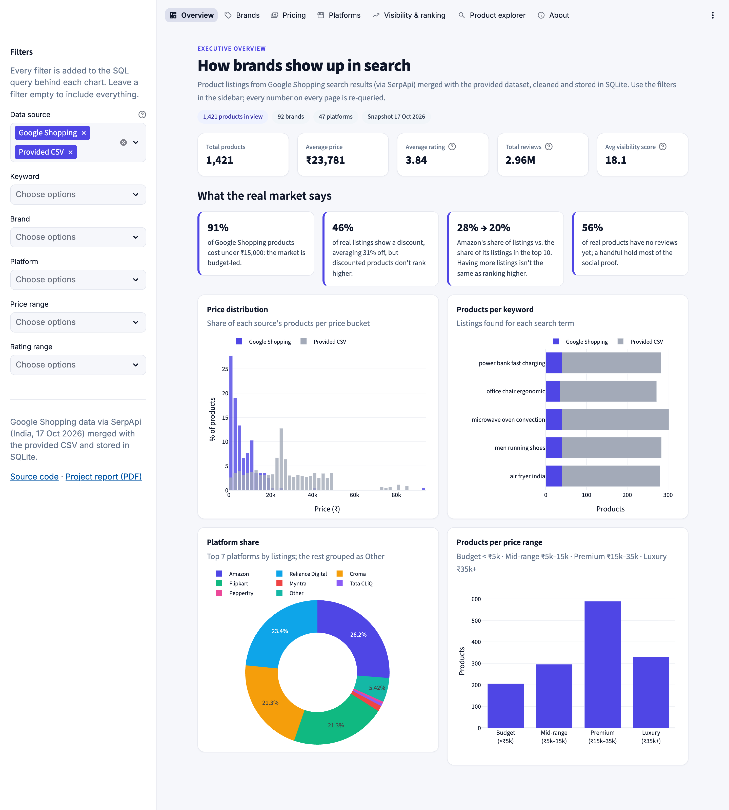

# Brand Visibility Intelligence Dashboard

Analyses how brands perform in e-commerce search results (ranking, pricing, discounts and platform
competition) using **Google Shopping data pulled through SerpApi**, merged with the provided
`brand_dirty_dataset.csv`, cleaned, stored in **SQLite** and explored in a **Streamlit** dashboard.

**Live dashboard:** https://brand-visibility-intelligence.streamlit.app
**Project report:** [`reports/Brand_Visibility_Intelligence_Report.pdf`](reports/Brand_Visibility_Intelligence_Report.pdf)



## Key findings

1. **The provided CSV is synthetic.** Every one of its 9 brands sells every product (Dell air fryers, Nike
   microwaves) and it has no search positions, so ranking and brand conclusions come from the real Google
   Shopping data.
2. **Visibility can't be bought with price, discounts or ratings.** None of them correlates with search
   position, and together with reviews they predict a top-10 spot barely better than chance (AUC 0.55).
3. **Having more listings doesn't mean ranking higher.** Amazon has 28% of listings but only 20% of them
   reach the top 10. Pepperfry has 7 listings and 5 are in the top 10.
4. **The real market is budget-led:** 91% of products cost under ₹15,000.
5. **Discounting is a platform habit:** AJIO and Flipkart discount every listing, Amazon only 31% of its
   listings, and discounted products don't rank better.

## Project structure

```
SerpApi JSON ─┐
              ├─ merge ─ clean ─ features ─┬─ data/processed/clean_dataset.csv
dirty CSV ────┘                            └─ data/brand_visibility.db (SQLite) ─ Streamlit dashboard
```

| Path | Role |
|---|---|
| `config.py` | Paths, API parameters, keywords, and every cleaning, feature and dashboard rule (nothing is hard-coded elsewhere) |
| `src/extract.py` | SerpApi calls, per-keyword JSON cache, flattening to rows |
| `src/load.py` | Reads the CSV, aligns it to the shared schema, merges with `concat` |
| `src/clean.py` | Eight ordered cleaning steps with a per-step change log |
| `src/features.py` | Brand, visibility score, price/rating/review bands, discount |
| `src/db.py` | SQLite schema: `products`, `raw_products`, `cleaning_log` tables; `brand_summary`, `platform_summary`, `keyword_summary` views |
| `pipeline.py` | Runs the whole ETL (`--refresh-api` to call SerpApi again) |
| `notebooks/eda.ipynb` | Answers the 30 data-cleaning and 30 EDA questions; charts saved to `reports/figures/` |
| `app/streamlit_app.py` | Dashboard entry point: theme, sidebar filters, navigation |
| `app/views.py` | One function per dashboard page |
| `app/queries.py` | All dashboard SQL; the sidebar filters become one parameterised `WHERE` clause |
| `app/ui.py` | Styling, chart template and layout helpers |
| `data/` | Raw CSV, cached SerpApi responses, cleaned CSV, SQLite database |
| `reports/` | Project report (PDF), dashboard screenshots, EDA figures |

## Run it

```bash
pip install -r requirements.txt
cp .env.example .env            # add your SerpApi key (only needed to re-fetch)
python pipeline.py              # rebuild the clean CSV and the database from the cached API data
jupyter notebook notebooks/eda.ipynb
streamlit run app/streamlit_app.py
```

The repository ships with the cached API responses and the built database, so the dashboard runs without
an API key. `app/requirements.txt` holds the dashboard's own pinned dependencies (used by Streamlit Cloud).

## Dashboard

Seven pages: **Overview, Brands, Pricing, Platforms, Visibility & ranking, Product explorer, About.** The sidebar
filters (data source, keyword, brand, platform, price range, rating range) and the explorer's title search
build a parameterised SQL `WHERE` clause, so every KPI and chart is a fresh SQLite query.
The explorer has search, sortable columns, top-performer highlighting and CSV download.

Two display rules keep the numbers honest:
- **Discount and ranking averages use Google Shopping rows only.** The CSV has no original prices (every CSV
  discount would be 0) and no real search positions. Mixing it in would make Amazon's average discount about 1%
  and its average position about 100. Those charts say "Google Shopping" in their subtitle.
- **Average ratings use real ratings only.** Filled-in ratings are excluded, and "best rated" rankings need at
  least 3 rated listings (`MIN_LISTINGS_FOR_AVG`).

## Assumptions

- **Ranking means `position`** (search rank, 1 = top). The brief sometimes writes "rating (ranking)"; star rating
  and search rank are treated as separate columns throughout.
- **CSV position:** the CSV has no rank column, so a row's order within its keyword is taken as its position.
- **Visibility score** = `100 / log2(position + 1)`: 100 at #1, 63 at #2, 29 at #10. It decays like click-through,
  so the gap between #1 and #5 matters more than between #41 and #45.
- **Discount:** when no original price is listed (all CSV rows, many API rows), `raw_price` = `price` and the
  discount is 0. `discount_amount` = `raw_price − price`; `discount_pct` = that as a % of `raw_price`.
- **API original price** is read from the ₹ amount in `old_price`. SerpApi's own `extracted_old_price` returns the
  *percentage* for strings like `"60% off₹990"` (it gives 60, not 990), so it is only used when it exceeds the price.
- **Installment offers:** for "₹X/mo" listings `extracted_price` is the monthly amount, so price = monthly × `period`.
- **API volume:** one page (40 ranked results) per keyword; SerpApi ignores `start`/`num` for this engine.
- **API ranking:** only the main `shopping_results` list is used. The `categorized_shopping_results` carousels
  ("Deals", "Under ₹7,000") restart their positions at 1, so their ranks aren't comparable.
- **Brand:** a known brand anywhere in the title, otherwise the first word. Titles that open with a generic word
  or a size/spec token ("Men…", "Air Fryer…", "27L…") are labelled `Unbranded`.
- **Review bands** are fixed: No reviews / 1–99 / 100–999 / 1,000+.
- **Locale:** SerpApi is queried with `gl=in`, so prices are in INR like the CSV. Snapshot taken 17 Oct 2026.

## Cleaning decisions

| Issue | Treatment |
|---|---|
| `"Not Available"` price, `"many"` reviews | Treated as missing |
| `-999` price | Invalid placeholder → missing |
| Missing price / rating / reviews | Median for the same keyword *and* source (synthetic CSV values never fill real API gaps), flagged in `*_imputed` columns. A Google Shopping listing with no review count has **0** reviews |
| Price outliers (e.g. a ₹4.9 lakh power bank) | CSV only: capped at the per-keyword Q3 + 1.5×IQR, flagged in `price_capped`. Real API prices are left as they are |
| `"!!!"` and other noise in titles | Removed, whitespace collapsed |
| `amazon` / `AMAZON` / `Amazon.in` | Mapped to one platform name |
| Duplicates | Same keyword + title + platform + price, checked *after* text cleaning: 94 CSV and 5 API rows removed |
| Delivery | Normalised to Free Delivery / N Days / Paid Delivery / Unknown |

## Deliverables

| Brief requirement | Where |
|---|---|
| Source code | `src/`, `pipeline.py`, `app/`, `notebooks/eda.ipynb` |
| Clean dataset (CSV) | `data/processed/clean_dataset.csv` |
| Dashboard | `app/` (Streamlit), live link above |
| Project report | `reports/Brand_Visibility_Intelligence_Report.pdf` |
| Dashboard screenshots | `reports/screenshots/` |
| SQL database | `data/brand_visibility.db` |
